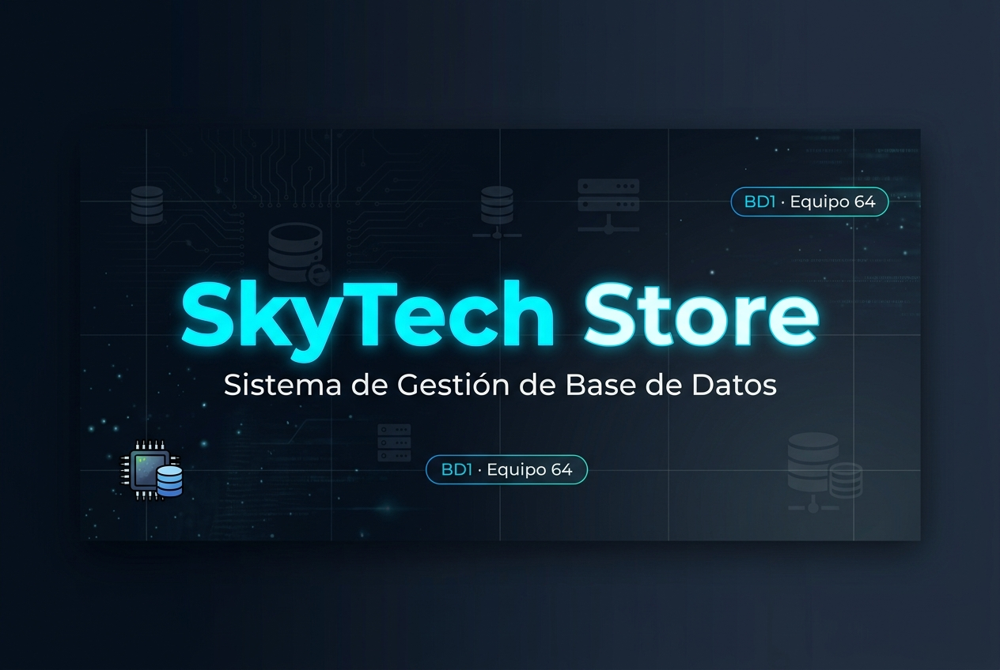

<div align="center">



# SkyTech Store · BD1 — Equipo 64

**Sistema de Gestión de Base de Datos Relacional para e-Commerce de Tecnología**


</div>

---

## 📋 Descripción del Proyecto

**SkyTech Store** es una tienda de comercio electrónico dedicada a la comercialización de componentes de tecnología, hardware e insumos informáticos. Este proyecto contempla el diseño, normalización e implementación de una **base de datos relacional** que soporta el ciclo completo de operaciones de venta.

El sistema gestiona:
- 🗂️ Catálogo de productos organizados por categorías y SKU único
- 👤 Registro y autenticación de clientes
- 🛒 Persistencia interactiva del carrito de compras activo
- 🧾 Procesamiento y conversión de carritos a órdenes de venta
- 💳 Registro de métodos de pago
- 🔒 Historial inalterable de transacciones y precios para auditoría

---

## 🎯 Alcance y Restricciones

| Aspecto | Detalle |
|---|---|
| **Dominio** | E-commerce de hardware e insumos informáticos |
| **Tablas** | Entre **6 y 10 relaciones** (justificadas según el dominio) |
| **Normalización** | Obligatoria hasta **Tercera Forma Normal (3FN)** |
| **Motor de BD** | Microsoft SQL Server (T-SQL) |

---

## 🗂️ Reglas de Negocio

| # | Regla | Invariante |
|---|---|---|
| **RN-1** | Registro de Clientes | `email` único e inalterable (`UNIQUE`) |
| **RN-2** | Gestión y Control de Stock | `stock >= 0`; cantidad vendida `<= stock disponible` |
| **RN-3** | Congelamiento de Precios en Ventas | `precio_unitario_congelado` almacenado en `DETALLE_PEDIDO` |
| **RN-4** | Persistencia y Exclusividad del Carrito | Un único carrito en estado `'Pendiente'` por usuario |
| **RN-5** | Métodos de Pago | Todo pedido vinculado a un `metodo_pago_id` válido |
| **RN-6** | Integridad del Detalle de Pedido | `cantidad > 0` en cada ítem |
| **RN-7** | Categorización y SKU de Producto | Categoría obligatoria (`NOT NULL`) y `SKU` único |

---

## 🚀 Etapas y Entregables

### Etapa I — Requerimientos y Dominio del Negocio
> Descripción del caso, reglas de negocio y alcance del sistema.

- Descripción del rubro elegido e introducción al caso de estudio
- **7 Reglas de Negocio** documentadas (gestión de stock, clientes, precios, carrito, métodos de pago, integridad de pedido y categorización)

### Etapa II — Modelado Conceptual y Lógico
> Representación formal de las entidades y sus relaciones.

- **Diagrama Entidad-Relación (DER):** Notación P. Chen — ERDPlus
- **Modelo Relacional:** Tablas con claves primarias (PK) y foráneas (FK)
- **Proceso de Normalización** paso a paso:
  - `1FN` → Atomicidad y eliminación de grupos repetitivos
  - `2FN` → Eliminación de dependencias parciales sobre claves compuestas
  - `3FN` → Eliminación de dependencias transitivas entre atributos no clave

### Etapa III — Implementación Física (Scripts SQL)
> Construcción del esquema en Microsoft SQL Server.

- **DDL:** Creación de tablas, `PRIMARY KEY`, `FOREIGN KEY` (con reglas `ON DELETE`/`ON UPDATE`), tipos de datos (`VARCHAR`, `DECIMAL`, `DATETIME2`) y restricciones (`NOT NULL`, `UNIQUE`, `CHECK`)
- **DML:** Poblado inicial con al menos **8–10 registros coherentes** por tabla

### Etapa IV — Consultas y Casos de Uso
> Extracción de información mediante SQL.

- 🧾 **Factura/Comprobante:** Encabezado + detalle de venta con sub-totales y total acumulado
- 📊 **Reporte Agregado:** Ventas por vendedor/categoría en rango de fechas (`GROUP BY`, `SUM`, `COUNT`)
- 🔍 **Consulta Avanzada:** Cruce de ≥ 3 tablas con `JOIN` y filtros condicionales (`HAVING` / subconsultas)

### Etapa V — Implementación de Temas Técnicos
> Componentes que hacen la base de datos robusta, rápida, segura y mantenible.

| Tema Técnico | Descripción |
|---|---|
| ⚙️ **Procedimientos y Funciones Almacenadas** | Encapsulado de lógica de negocio reutilizable |
| 🔄 **Manejo de Transacciones** | Garantía de atomicidad con `BEGIN / COMMIT / ROLLBACK` |
| 🛡️ **Triggers de Auditoría** | Registro automático de cambios críticos |
| 🔐 **Seguridad** | Roles, permisos y usuarios de base de datos |
| ⚡ **Índices (Optimización)** | Mejora del rendimiento en consultas frecuentes |

---

## 📅 Cronograma

| Etapa | Pregunta que responde | Producto | Entrega |
|---|---|---|---|
| **I. Requerimientos** | ¿Qué necesita el negocio? | Requerimientos + reglas | Vie 04/09 |
| **II. Modelado** | ¿Cómo representamos la información? | DER + modelo relacional + 3FN | Vie 11/09 |
| **III. Implementación** | ¿Cómo construimos la BD? | DDL + DML | Mié 30/09 |
| **IV. Consultas** | ¿Cómo obtenemos información? | SQL + casos de uso | Vie 16/10 |
| **V. Temas técnicos** | ¿Cómo hacemos la solución más robusta? | Procedimientos, transacciones, triggers, seguridad e índices | Jue 29/10 |

---

## 📁 Estructura del Repositorio

```
proyecto-bd1-equipo_64/
│
├── README.md                        # Este archivo
├── LICENSE
│
├── docs/                            # Documentación por etapas
│   ├── banner.jpg                   # Banner del proyecto
│   ├── etapa-01/                    # Requerimientos y dominio
│   │   ├── descripcion-caso.md
│   │   ├── reglas-negocio.md
│   │   ├── alcance.md
│   │   └── decisiones-diseno.md
│   ├── etapa-02/                    # Modelado conceptual y lógico
│   │   ├── modelado-relacional.md
│   │   ├── normalizacion.md
│   │   ├── Decisiones-diseno.md
│   │   └── Der/
│   ├── etapa-03/                    # Implementación física
│   ├── etapa-04/                    # Consultas SQL
│   └── etapa-05/                    # Temas técnicos
│
├── sql/                             # Scripts SQL ejecutables
│   ├── ddl/
│   │   └── crear_db.sql             # Definición del esquema completo
│   ├── dml/                         # Inserción de datos de prueba
│   ├── consultas/                   # Consultas de negocio (Etapa IV)
│   ├── tecnico/                     # Scripts técnicos (Etapa V)
│   └── prueba_validaciones.sql      # Pruebas de restricciones
│
└── modelos/                         # Modelos de datos
    └── der/                         # Diagrama Entidad-Relación
```

---

## 🗃️ Modelo de Datos (Resumen)

El esquema cuenta con **8 tablas** que cubren el dominio completo del e-commerce:

```
USUARIO ──< CARRITO ──< ITEMS_CARRITO >── PRODUCTO >── CATEGORIA
   │                                           │
   └──────────< PEDIDO >── METODOS_PAGO        │
                   │                           │
                   └──< DETALLE_PEDIDO >───────┘
```

| Tabla | Descripción |
|---|---|
| `USUARIO` | Clientes registrados en la plataforma |
| `CATEGORIA` | Líneas de productos del catálogo |
| `PRODUCTO` | Ítems del catálogo (SKU, precio, stock) |
| `CARRITO` | Sesión de compra activa del usuario |
| `ITEMS_CARRITO` | Productos agregados al carrito |
| `METODOS_PAGO` | Medios de pago disponibles |
| `PEDIDO` | Órdenes de venta confirmadas |
| `DETALLE_PEDIDO` | Líneas del pedido con precio congelado |

---

## 👥 Integrantes

<div align="center">

| N° | Apellido y Nombre | Rol |
|:---:|---|:---:|
| 1 | **Azcona**, Ivana Gisel | 👩‍💻 Desarrolladora |
| 2 | **Rodríguez**, Noelia del Pilar | 👩‍💻 Desarrolladora |
| 3 | **Sandoval**, Juan Benjamín | 👨‍💻 Desarrollador |
| 4 | **Vallejos**, Gustavo Oscar | 👨‍💻 Desarrollador |

**Bases de Datos I — Equipo 64**

</div>

---

## ⚙️ Tecnologías Utilizadas

<div align="center">


</div>

---

<div align="center">

*Proyecto académico — Bases de Datos I · 2026*

</div>
